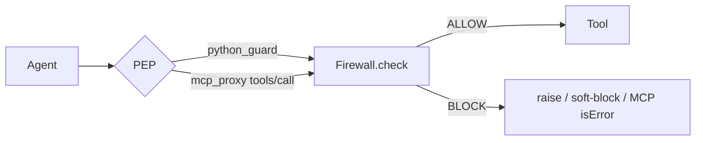

# Docs index

| Doc | Purpose |
|-----|---------|
| **[GETTING_STARTED.md](GETTING_STARTED.md)** | Install → identity → `zta` → first BLOCK |
| **[INTEGRATION.md](INTEGRATION.md)** | **Put Tracewall on the tool-call path** (guard / MCP proxy / GuardedToolNode) |
| **[ARCHITECTURE_OVERVIEW.md](ARCHITECTURE_OVERVIEW.md)** | Pipeline / modules / network diagrams, ALLOW·BLOCK, tests done, QA gaps |
| **[RESULTS.md](RESULTS.md)** | How to read eval JSON / ASR vs utility (AgentDojo = banking slice) |
| **[RUNBOOK.md](RUNBOOK.md)** | Profiles, env, audit, BLOCK storms, soft-block |
| [FIREWALL.md](FIREWALL.md) | Architecture / pipeline / modules (detail) |
| [GOALS.md](GOALS.md) | Success **and** failure criteria (Fable) |
| [TEST_PLAN.md](TEST_PLAN.md) | Scenario lanes; harness ≠ scenario suite |
| [DETECTION.md](DETECTION.md) | What detection work fits the POC |
| [TOOLING.md](TOOLING.md) | Cursor skills + user-local agent tooling (caveman, GSD, graphify, …) |
| [SUPPORT.md](SUPPORT.md) | Support matrix (Python / MCP / profiles / metrics) |
| [ENTERPRISE.md](ENTERPRISE.md) | Enterprise readiness checklist (honest) |
| **[DEVSECOPS.md](DEVSECOPS.md)** | CI/deploy gates — build-blocker honesty vs SAST |
| [plans/2026-10-21-tracewall-core-enhancement-test-plan.md](plans/2026-10-21-tracewall-core-enhancement-test-plan.md) | Post-freeze core enhancement + test plan (**awaiting Final Gate**) |
| [plans/2026-10-21-tracewall-karpathy-review.md](plans/2026-10-21-tracewall-karpathy-review.md) | Karpathy lens review (**separate**; not merged into autoplan) |
| [../TODOS.md](../TODOS.md) | Deferred backlog from autoplan |
| [../SECURITY.md](../SECURITY.md) | Threat model + what we don’t protect |
| [../CHANGELOG.md](../CHANGELOG.md) | Versioned release notes |
| [../HANDOFF.md](../HANDOFF.md) | Pick-up status + roadmap (claim freeze; gate pending) |
| [../AGENTS.md](../AGENTS.md) | Agent entry: product truth + tooling pointers |
| [../paper/EVIDENCE.md](../paper/EVIDENCE.md) | Claim ledger (repo → paper) |
| [../LESSONS_LEARNED.md](../LESSONS_LEARNED.md) | Process rules (incl. PEP ≠ chat scanner) |
| [../.cursor/skills/tracewall-zta/SKILL.md](../.cursor/skills/tracewall-zta/SKILL.md) | ZTA / blast-radius skill |
| [../.cursor/skills/tracewall-paper/SKILL.md](../.cursor/skills/tracewall-paper/SKILL.md) | Paper evidence→claim skill |

## Tracewall at a glance

**Tool-call PEP:** `await firewall.check(event)` → ALLOW or BLOCK on screened
tool calls — **not** a chat-stream prompt scanner, OS sandbox, or on-disk file
scanner. Tier-0 is a noisy prior on **tool args** and never sole-BLOCKs.

Fast path is L0 → content → policy → trust/taint gate; semantic only on escalate /
content-flag. PEPs: in-process `guard` / `GuardedToolNode`, or MCP stdio
`mcp_proxy` (screens `tools/call` only). Profiles: `zta` / `paranoid` /
`balanced` / `permissive`.

**First integration step:** [`INTEGRATION.md`](INTEGRATION.md).  
**Threat model:** [`../SECURITY.md`](../SECURITY.md).

Full diagrams, test inventory, and QA gap matrix:
[`ARCHITECTURE_OVERVIEW.md`](ARCHITECTURE_OVERVIEW.md).

## Paper

- Draft: [`paper/PAPER.md`](../paper/PAPER.md); in-repo PDF: [`paper/tracewall.pdf`](../paper/tracewall.pdf)  
- **Reliable PDF download:** [releases/download/v0.2.0/tracewall.pdf](https://github.com/beejak/agentwatch-firewall/releases/download/v0.2.0/tracewall.pdf) (prefer if GitHub blob preview fails)  
- Evidence-only claims: [`paper/EVIDENCE.md`](../paper/EVIDENCE.md) · folder index: [`paper/README.md`](../paper/README.md)  
- Author **beejak**; library **v0.3.0**; **paper claim set frozen** (do not rewrite freeze quotes).  
- Post-freeze shipped: E1/E2/E4 — see [`../CHANGELOG.md`](../CHANGELOG.md), [`DEVSECOPS.md`](DEVSECOPS.md).  
- CI: AgentDojo soft-block skipped without `[bench]` (`320ee56`); suite collects green.  
- `paper/watchtower.tex` is **stale brand** — do not submit.
